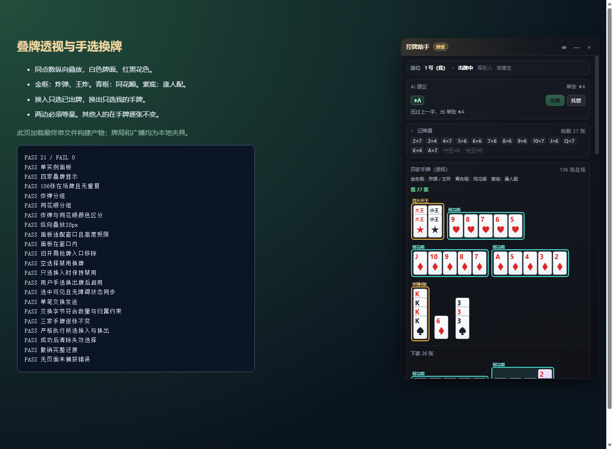

# 控牌助手 · 斗地主 / 掼蛋 · v2.2.0

四家叠牌透视、炸弹与同花顺高亮、记牌器、AI 建议，以及手选已出牌交换。

## 安装

先安装 [Tampermonkey](https://www.tampermonkey.net/) 或 Violentmonkey，再打开：

[安装 / 更新单文件脚本](https://raw.githubusercontent.com/qiaoda2021/hullqin-deck-forge/main/dist/hullqin-deck-forge.user.js)

脚本匹配 `https://game.hullqin.cn/*`。进入斗地主或掼蛋牌桌后显示面板。
已有用户在扩展中执行「检查更新」。版本号由构建源码统一生成。

## 界面与本地预览

打开 [交互预览](demo/preview.html)，或打开加载最终构建产物的 [浏览器验收页](test/browser.html)。两页都使用本地牌局和假广播，不连接线上游戏。



- 白底牌面，红黑花色；同点数纵向叠放，不同点数分列。
- 金框表示炸弹或王炸，青框表示同花顺，紫底表示掼蛋逢人配。
- 分组不重复使用物理牌。三人斗地主使用双王；四人两副牌模式须集齐四王。
- 面板宽度随窄窗口收缩，内容区可纵向滚动；向下滚动可见交换区。
- 牌面复现分列叠放布局，不含参考图的人物插画，不是像素级复刻。

## 手选交换

1. 在「已出牌换入」中逐张选择目标物理牌。
2. 在「我的换出牌」中逐张选择当前手牌。
3. 两边张数相同，且方案通过审计后，才启用「换牌」。
4. 「换牌并出牌」仅在本人回合启用，通过广播确认后模拟页面选牌和出牌。

### 固定约束

- 换入必须出现在出牌流水中，且当前没有座位持有。
- 其他人的在手牌、自己的在手牌、未发暗池和未认领底牌均不是换入来源。
- 换出仅使用用户明确选择的本人当前手牌；没有自动代选，也不执行部分方案。
- 每家手牌张数保持不变，其他人的在手牌逐张保持不变。
- 为避免物理牌同时在手中和流水中出现，流水原目标位置会替换为对应换出牌。
- 动作分隔与动作张数保持；原牌型须保留，掼蛋解释码随牌面更新。
- 逐手复用站点规则检查压牌关系；掼蛋复用站点回放识别当前墩和过牌重置。
- 结构审计不等于从真实初始牌序验证整个对局；它不证明初始发牌或旧历史本身可信。

### 广播与撤销

使用页面已有 `PlayerUpdateGameData` 通道发送。先检查目标状态是否已广播确认，再判断版本或原状态冲突。
原状态与原版本均未变化时，超时最多重试一次。出现他人后续动作时停止，不把旧快照覆盖回去。
撤销限 60 秒，且当前状态必须仍与交换后的目标完全相同；等待广播时禁用撤销。

### v2.2.0 行为变更

**开局预设入口与自动改发牌路径已停用。** 旧 `dg.deal` 存档不再触发自动交换。
保留 `getDeal/setDeal` 兼容表面，但 `auto` 固定为 `false`。
旧版从他人手牌或暗池取牌的行为不再支持，旧 `allowPool/allowHole` 参数不形成旁路。
详情见 [更新日志](CHANGELOG.md)。

## 其他功能

- 四家透视：按当前页面提供的完整牌局数据展示手牌。
- 记牌器：点数剩余、最近出牌流水、剩余张数和威胁提示。
- AI：斗地主 / 掼蛋本地规则引擎给出建议，可点「出牌」或启用托管。
- 不调用外部模型 API，不需要 API Key；交换和出牌仍会通过页面通道发送游戏消息。
- `Alt+D` 显示 / 隐藏面板；`Alt+F` 执行当前交换；`Alt+A` 执行当前 AI 建议。

## 开发与验收

需要 Node.js 18+；本次在 Windows、Node.js 24.22.1 和 Edge 上验收，无需安装 npm 依赖。

```powershell
node build.js
node test/all.js
```

最终 Node 回归：**514 / 514**。浏览器最终结果见 [验收记录](CHANGELOG.md#验收记录)。

| 文件 | 职责 |
| --- | --- |
| [dg.core.js](dg.core.js) | 牌模型、交换规划、独立审计、流水与分组 |
| [dg.site.js](dg.site.js) | fiber 读取、双向选择、发送确认、重试与撤销 |
| [dg.site.ui.js](dg.site.ui.js) | Shadow DOM 面板、叠牌、高亮与选牌 |
| [dg.ai.js](dg.ai.js) / [dg.recorder.js](dg.recorder.js) | 本地 AI 与记牌器 |
| [vendor](vendor/README.md) | 随仓库分发的站点规则引擎 |
| [build.js](build.js) | 内联依赖并生成单文件脚本 |
| [test/all.js](test/all.js) | 七组 Node 回归，含发布器模拟测试 |
| [tools/push-github.mjs](tools/push-github.mjs) | vault-only 凭据、白名单、秘密扫描和保留式更新 |

控制台接口示例：

```js
HQX.read()
HQX.forge([TARGET_CARD_ID], false, {give: [MY_CARD_ID]})
HQX.aiSuggest()
HQX.recorder()
```

## 验证边界

本次使用本地假牌局、假广播及真实 Edge 渲染最终脚本。未验证线上真实牌桌、服务器接受情况、用户已安装扩展或实体手机触控体验。
站点若改变完整状态下发、协议或服务端校验，部分功能会失效；以实际运行结果为准。

## 上传与许可

仅更新 [qiaoda2021/hullqin-deck-forge](https://github.com/qiaoda2021/hullqin-deck-forge)，不上传父目录。
凭据仅从本地 DPAPI vault 读取，发布步骤见 [PUSH.md](PUSH.md)。

MIT，见 [LICENSE](LICENSE)。
